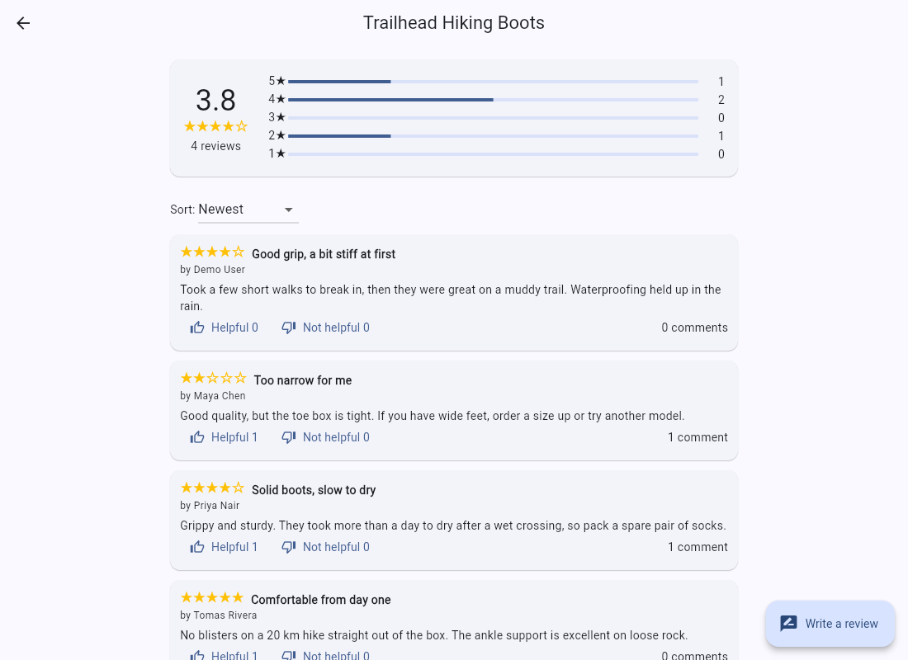

# SimpleAPI Reviews API: Flutter web sample

A small Flutter web app that shows how to call the free [SimpleAPI Reviews API](https://reviews.simpleapi.dev/docs) from a browser, with no backend of your own.

**[Live demo](https://simple-api-dev.github.io/reviews-client/)** | **[API docs](https://reviews.simpleapi.dev/docs)** | **[Get a free key](https://keys.simpleapi.dev/?product=reviews)**



## Run it

You need the [Flutter SDK](https://docs.flutter.dev/get-started/install) (stable; CI uses 3.47.8).

```bash
flutter pub get
flutter run -d chrome --dart-define=SIMPLEAPI_KEY=YOUR_KEY
```

The app uses only the key passed with `--dart-define`; there is no key entry in the app. On the live demo, press **Try the demo account** on the login screen to log in as the shared demo user in one click. Run the tests (all HTTP is mocked, nothing calls the real API):

```bash
flutter test
```

## How it calls the API

Every call is one method in [`lib/reviews_api.dart`](lib/reviews_api.dart). The key goes in the `apikey` query parameter; writes also send the user's bearer token:

```dart
final uri = Uri.https('reviews.simpleapi.dev', '/api/reviews', {'subject': 'pizza-palace', 'apikey': apiKey});
final response = await http.get(uri, headers: {
  'Accept': 'application/json',
  if (token != null) 'Authorization': 'Bearer $token', // writes only
});
```

The rest of the app never touches HTTP. The login token is held in memory only, so reloading the page logs you out.

## Screens and API calls

| Screen | What it does | Calls |
| --- | --- | --- |
| **Subjects** (`subjects_screen.dart`) | The landing screen, with a back arrow to simpleapi.dev. Browse things that have reviews, with count and average; search by name prefix; start a review for a new subject. | `GET /api/subjects` |
| **Log in / Register** (`auth_screen.dart`) | Get a token, or press **Try the demo account** to log in as the shared demo user. Opened automatically when you try to write or vote. | `POST /api/users/register`, `POST /api/users/login`, `POST /api/users/logout` |
| **Delete my account** (`delete_account_dialog.dart`) | Shown in the Subjects bar when logged in. Asks for your password; the checkbox "Also delete my reviews and comments" adds `purge=true`. | `DELETE /api/users/me` (password in the JSON body), `DELETE /api/users/me?purge=true` |
| **Reviews** (`reviews_screen.dart`) | One subject: average, 1-5 star breakdown, sortable reviews, helpful / not helpful votes (click again to take a vote back), write a review. | `GET /api/reviews?subject=`, `POST /api/reviews`, `POST /api/reviews/{id}/helpful`, `POST /api/reviews/{id}/unhelpful`, `DELETE /api/reviews/{id}/vote` |
| **Review** (`review_screen.dart`) | A review with its comments; add a comment. | `GET /api/reviews/{id}/comments`, `POST /api/reviews/{id}/comments` |

The API also has calls this sample does not use (editing and deleting your own reviews and comments, `GET /api/users/me`, password reset, listing a user's reviews); see the [full docs](https://reviews.simpleapi.dev/docs).

## Use your own key

The live demo is built with a shared demo key. To run the app on your own key, get a free one at [keys.simpleapi.dev](https://keys.simpleapi.dev/?product=reviews) (email, 6 digit code, done) and start it with:

```bash
flutter run -d chrome --dart-define=SIMPLEAPI_KEY=YOUR_KEY
```

Keys are sent only to `reviews.simpleapi.dev`. Reading needs just the key. Writing (reviews, comments, votes) also needs a logged-in user, whom you can register inside the app. Users belong to your key, so every developer has their own set of users.

## The demo account

The live demo has a shared demo user, `demo@simpleapi.dev` with the password `try-the-demo`, behind the **Try the demo account** button (the constants are in [`lib/config.dart`](lib/config.dart); they are public by design). The login and register screens say: "This is a shared demo. Data resets every night. Do not use a real password or any private details." When the demo key has no room for another user, registering shows "The demo is full. It resets every night." Every night the demo's users and content are deleted and the sample data is restored.

## Good to know

- Errors come back as `{"message": "..."}`. The app turns the common ones into the same short sentences in all the SimpleAPI samples (see `describeError` in `lib/screens/ui.dart`) and shows the API's own message for 401 on login, 403, 409 and 422.
- A bad or missing key answers `401`. So does a wrong email or password on login (`"Invalid email or password."`), which is not an expired session. A token that is no longer valid also answers `401`: the app drops it and asks the user to log in again. Login and register never send the bearer token.
- Register: `201` with a token, `409` if the email is taken, `422` for invalid input, `400` for a malformed JSON body, `403` when the key already has 25 users.
- Registering with the email address your key belongs to answers `202` and emails a confirmation code instead of returning a token (`POST /api/users/register/confirm`). The sample shows the message but does not implement the confirmation step; use a different address to try it out.
- `DELETE /api/users/me` needs your password in the JSON body (`403` if wrong, `422` if missing). Without `purge=true` your reviews and comments stay, attributed to your deleted user id; with it they are deleted and the vote counters are recounted.
- You get one review per user per subject; a second one answers `409`.
- The API allows 60 requests a minute per IP address and answers `429` beyond that.

## Project layout

```
lib/reviews_api.dart      the whole API client
lib/models.dart           response classes
lib/app_state.dart        the API client + logged-in user (a ChangeNotifier)
lib/open_url*.dart        opens a link in the same tab (the back arrow)
lib/config.dart           the build-time key (SIMPLEAPI_KEY), the demo account
lib/screens/              the screens (ui.dart holds the shared widgets and error wording)
test/                     unit tests for the client, widget tests for the app
```

## Deploy to GitHub Pages

[`.github/workflows/pages.yml`](.github/workflows/pages.yml) runs on every push to `main`: it installs Flutter, runs `flutter analyze` and `flutter test`, builds with `flutter build web --release --base-href /reviews-client/` and publishes through the official `upload-pages-artifact` and `deploy-pages` actions.

To use it in your own copy:

1. Set **Settings -> Pages -> Source** to **GitHub Actions**.
2. Add a repository **variable** (not a secret) named `SIMPLEAPI_KEY` under **Settings -> Secrets and variables -> Actions -> Variables**. The workflow builds with `--dart-define=SIMPLEAPI_KEY=...`.
3. If you rename the repository, change `--base-href` in the workflow to match.

Anything passed with `--dart-define` ends up in the compiled JavaScript, so anyone can read it from the deployed site. Use a free key made for a public demo. If the variable is empty, every call is rejected with a 401 and the app shows the error message.

## License

[MIT](LICENSE)
